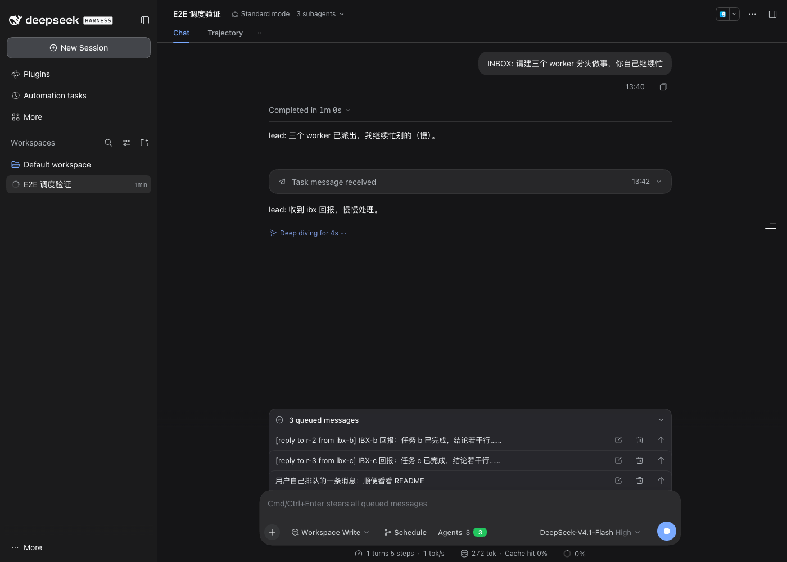
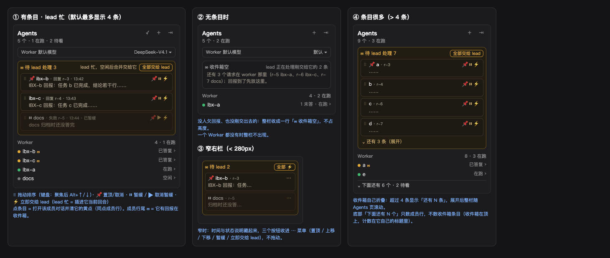
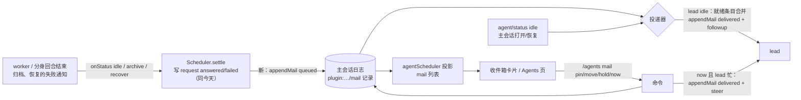

# lead 收件箱（lead inbox）设计稿

> 状态：**已定稿，实现中**。用户 CR 结论：方案 B；收件箱放在 **Agents 页顶部独立分区**（第 3.1 节）；第 5 节各点已定。
> 基线：`main` @ e149cba（v0.1.0-rc.3）；宿主：本机 DeepSeek Harness 0.2.2-rc.1（app.asar）。
> 用户原话：「各个 worker 的消息是阻塞在对话框的上面，和用户的排队列表放在一块了……这样用户也没办法自己调整优先级，也不好看」。

## 0. 结论先行

- **为什么出现在排队列表**：插件把 worker 答复、分身结论、请求失败通知都用 `Agent.followup()` 塞进 lead 的 DSH inbox 的 `next-turn` 列表；DSH 输入框上方的 QueueDock 渲染的正是 `next-turn` 的全部行（只过滤掉还停在对话流里的用户回显），所以插件消息和用户自己排队的消息在同一个列表里。
- **对优先级的实际影响**：DSH 每个回合只从 `next-turn` 取 **一条**，严格按到达顺序（FIFO），并且只要还有排队就一直不进入空闲。N 条 worker 回报 = lead 连跑 N 个回合；用户在它们之后排的消息要等这 N 个回合全跑完。用户在列表里只能对每行「编辑 / 删除 / 插话发送」，**不能排序**；而且编辑或删除一条 worker 回报会让 lead 读到被改过的内容或根本读不到，但插件账本里那条请求已经记成「已答复」——静默丢失。
- **推荐**：方案 B「插件自己的收件箱」——lead 忙时，插件消息先进插件自己的、持久化在主会话日志里的收件箱，不进 DSH 队列；在 Agents 页顶部（头部与「Worker 默认模型」之下、Worker 列表之上）单独一栏展示，可置顶、拖动排序、暂缓、立即交给 lead；lead 空闲时把就绪的回报**合并成一条**交给 lead。用户自己的排队消息天然优先。只依赖 A 级宿主 API（`followup` / `steer` / `agent/status` / `agent/pre-step` / 插件记录 / 会话投影）；UI 放在插件自己已有的 Agents 页里，不新增宿主依赖。

## 1. 现状核实

### 1.1 插件怎么把消息交给 lead

所有「给 lead 的话」都汇到 `Scheduler.toLead`，再到适配层：

| 来源 | 位置 | 说明 |
|---|---|---|
| 成员回合结束（最常见路径） | [scheduler.ts:630-645](../src/scheduler.ts) `onStatus` → `settleInBackground` → `toLead` | 子会话变 idle 时立刻结算，把 `[reply to r-N from x]`、`[report from x]`、分身结论逐条 `toLead` |
| 归档时还没答完的请求 | [scheduler.ts:1028](../src/scheduler.ts)（`archive`） | `request r-N to x failed: …` |
| 重启恢复 | [scheduler.ts:1147、1198、1217](../src/scheduler.ts)（`recoverMember` / `resumeRequest`） | 失败通知、恢复后的答复 |
| `toLead` 本体 | [scheduler.ts:1373-1377](../src/scheduler.ts) | 主会话不可写就跳过（`recover` 会补） |
| 适配层 | [dsh/host/agent.ts:92-94](../src/dsh/host/agent.ts) | `main.followup(relayMessage(text, sender))` |
| 消息形状 | [dsh/host/session.ts:171-172](../src/dsh/host/session.ts) | `source: { kind: 'agent-message', form: 'relay', senderSessionId }` |

另一条次要路径：DSH 自己的子代理运行时在子会话结束时也会给父会话发一条 `subagent-settled` 通知——父会话 idle 时走 `queue`（= followup），忙时走 `steer`（`dsh-subagent/lib/index.js:2061-2071` `notifySettlement`）。插件在 `agent/pre-step` 里把它改写成真正的答复（[scheduler.ts:1232-1260](../src/scheduler.ts) `admit`）。但 `onStatus` 一般先于这条通知结算，`settleOnce` 去重后通知变空被丢掉，所以**绝大多数回报走的是上面 followup 那条路**。

宿主侧语义（`dsh-agent-loop/lib/index.js`）：

- `followup(m)` = 追加到 `next-turn` 并唤醒（:570）；`steer(m)` = 追加到 `next-step` 并唤醒（:573）。
- `claim()`：每一步取走**全部** `next-step`，只有回合第一步再从 `next-turn` 取 **1 条**（:103-106）。
- 回合结束后只要 `hasPending` 就立刻开下一回合，不进 idle（:827）。

### 1.2 输入框上方那个列表是谁画的

- 组件：`@deepseek-ai/dsh-client-ui-conversation` 的 `QueueDock`（`lib/client.js:19625` 起）。
- 挂载：插槽 `conversation.input.dock`（`kind: 'list'`，`scope: 'session'`，`lib/client.js:22355`），`queue` 的 `order: 20`，Todo 卡片 `order: 0`（:19928-19940、:22350）。
- 数据：`useProjection('inbox')['next-turn']`，只过滤「还停在对话流里的用户提交回显」（`source.kind === 'user'` 且 rpcId 在 transcript 回显里），**其余所有来源的行都照常显示**（:19628-19632；README `Use this package` 段：「QueueDock reads `next-turn` from the Session `inbox` projection … Other queued rows retain their normal display and actions」）。
- 每行操作：编辑（改文本）、删除、插话发送（steer 进当前回合）；空草稿时 Cmd/Ctrl+Enter「插话发送全部排队消息」，会把 worker 回报一起插进去。**没有排序、置顶、暂缓。**

### 1.3 lead 忙时实际怎么消费

隔离环境复现（`DSH_HOME=/tmp/inbox-gui/home`，mock 模型，调度开关**关**；lead 建 3 个 worker 后自己慢慢忙 60 秒，worker 1.5/3/4.5 秒后各自 report；随后用户再发一条）：



截图：`/tmp/lead-inbox-queue-dock.png`

观察：

1. 三条 `[reply to r-N from ibx-x]` 依次进 QueueDock，用户那条排在它们后面（「3 queued messages」）。
2. lead 第 1 回合结束后，第 2 回合只取了 r-1（对话流里一行「Task message received」，lead 又慢慢处理 20 秒）；r-2、r-3、用户消息继续排着，要再跑 2 个回合才轮到用户。
3. 每行都有编辑 / 删除 / 插话按钮，worker 回报和用户消息无区别。

调度开关**开**时：用户消息在插入 inbox 的那一刻就被 `onInserted` 交给分身（[scheduler.ts:527-532](../src/scheduler.ts)），不会停在 QueueDock；所以 QueueDock 里基本全是插件消息，用户截图就是这种情况——列表被 worker 回报占满，而每条都会让 lead 单独跑一回合。

### 1.4 现状的问题清单

| # | 问题 | 严重度 |
|---|---|---|
| P1 | 插件消息与用户排队消息同列，外观无区分，用户看不出哪些是自己发的 | 体验 |
| P2 | 没有排序 / 置顶 / 暂缓；用户消息被前面的回报堵住（调度关时） | 体验 |
| P3 | N 条回报 = N 个 lead 回合（每回合重发一遍完整前缀，提示缓存命中但仍按输入计费，且串行变慢） | 成本 / 速度 |
| P4 | 用户在 QueueDock 删除一条回报 → lead 永远读不到，但请求已记为 answered，Agents 页、请求卡片都显示已答复 | **静默丢失** |
| P5 | 用户编辑一条回报 → lead 读到的不是 worker 的原话，账本里的 answer 与 lead 所见不一致 | 一致性 |

## 2. 方案对比

共同硬约束：

- **答复不丢**：请求照常结算（`answered` / `failed` 记录与现在一样在结算时写），lead 没读到之前收件箱条目必须持久化，重启后照常投递。
- **兼容**：绿/黄/红点（#9 `seen` 记录，基于成员回合与请求状态，与「是否已交给 lead」无关）、请求卡片、i18n（en/zh 两份文案）、适配层边界（业务代码不直接碰宿主，`boundary.spec.ts`）。
- 用户自己排队的消息默认优先。

### 方案 A：改投递方式，不建收件箱（最小改动）

lead 忙时改用 `main.steer()`（进 `next-step`），idle 时仍 `followup()`。这正是 DSH 自己子代理结束通知的做法。

- 效果：回报不再进 QueueDock，在 lead 的下一个步骤边界直接进入当前回合（对话流里显示为插话行）；多条回报在同一步一起进，不再一条一个回合；用户排队消息不会被堵。
- 缺点：**没有任何用户可调的优先级**（不满足诉求的后半句）；lead 正在做的多步工作会被回报打断（模型在工具调用中途看到新消息，可能转去处理回报）；插话行仍能被用户在对话流里看到但不能管理。
- 宿主依赖：只有 `Agent.steer`（A 级，H7 同族）。
- 提示缓存：只在尾部追加，无影响；回合数减少。
- 工作量：适配层 + scheduler 各几行，测试改几个断言。

### 方案 B：插件自己的收件箱（推荐）

插件消息先进**插件自己的收件箱**（主会话日志里的插件记录 + 会话投影），由插件决定何时、按什么顺序、合并还是逐条交给 lead；在 Agents 页顶部单独一栏展示（用户 CR 定的位置，见 3.1）。

- 投递时机：
  - lead **idle**（`agent/status` → idle）且没有被用户暂缓的条目 → 把所有就绪条目按收件箱顺序**合并成一条**，`followup` 一次 → lead 开一个回合处理全部。lead 能变 idle 说明 DSH 自己的 `next-turn` 已空，所以**用户排队的消息天然先处理**。
  - lead **忙**：留在收件箱，不进 DSH 队列。用户点「立即交给 lead」→ 用 `steer` 进当前回合下一步（与方案 A 同语义，只是由用户决定）。
  - 新消息到达时 lead 已 idle：立即投递（行为和今天一样，用户几乎看不到收件箱卡片）。
- 用户操作：置顶、拖动排序、暂缓（暂缓的条目在空闲投递时跳过，直到用户取消暂缓）、立即交给 lead、全部立即交给 lead。**不提供编辑和删除**（避免 P4/P5）；也不提供「不交给 lead」（第 5 节）。
- 宿主依赖：`followup` / `steer`（A）、`agent/status`、`agent/pre-step`（A）、`appendPluginRecord` + `sessionProjections`（A，已在用）；UI 在 Agents 页（`sidebarRightTabs.register` + `sidebar.right.pane.tab`，已在用），不新增宿主依赖。
- 提示缓存：只在尾部追加，历史不改写；合并投递使回合数从 N 降到 1，总输入 token 下降。
- 风险：lead 若长期忙（用户持续给它排消息，调度关），回报会一直等——这正是「用户优先」的代价，卡片上明确显示「等 lead 空闲」并给「立即交给 lead」按钮。

### 方案 C：仍用 DSH 队列，只改展示与顺序

保持 `followup`，但：用 inbox 的 splice/replace 把插件消息合并成一条并挪到用户消息之后；再用 CSS/DOM 把 QueueDock 里 `agent-message` 行藏起来，另画卡片。

- 缺点：隐藏宿主行依赖 QueueDock 的 DOM 结构和 class（C 级，宿主一改就静默坏）；排序靠就地改宿主 inbox（`inbox.splice` 不在我们现有适配面里，B/C）；用户删除宿主行导致的 P4 仍可能发生（宿主「插话发送全部」快捷键也会带上）。
- 宿主依赖最深，不推荐。

### 对比一览

| | A 改 steer | **B 插件收件箱** | C 改宿主队列展示 |
|---|---|---|---|
| 不再混在用户排队列表 | ✅（变成对话流插话行） | ✅ 独立卡片 | ✅（靠隐藏宿主行） |
| 用户可调优先级 | ❌ | ✅ 置顶/排序/暂缓/立即 | 部分（只能做合并与后置） |
| 用户消息优先 | ✅ | ✅（天然） | ✅ |
| N 条回报的 lead 回合数 | ≈1（按步合并） | 1（空闲时合并） | 1 |
| 是否打断 lead 当前工作 | 会 | 默认不会；用户点「立即」才会 | 不会 |
| 杜绝误删/误改回报（P4/P5） | ✅ | ✅ | ❌ |
| 最深宿主依赖 | A | B（插槽名，可降级） | C（DOM/CSS） |
| 改动量 | 小 | 中 | 中，且脆 |

## 3. 推荐方案 B：交互稿

### 3.1 放在哪里（用户已定：Agents 页顶部独立分区）

位置：Agents 页头部（「Agents / N 个 · M 在跑」）和「Worker 默认模型」之下、Worker / 分身分组之上，单独一栏。只在主会话（lead）的 Agents 页出现；会话里还没有任何成员时不出现。

依赖：Agents 页本身（右栏 tab 类型 `sidebarRightTabs.register` + 插槽 `sidebar.right.pane.tab`，A 级，已在用）、会话投影 `agentScheduler`（A，已在用）、`/agents inbox …` 命令经 `remote.commands.execute`（已在用，见适配层 `dsh/client/services.ts`）。**不新增任何宿主依赖**，也不再碰输入框上方的 `conversation.input.dock`。



线框源文件：[lead-inbox-placement.html](img/lead-inbox-placement.html)。

### 3.2 交互

**有条目（①）**

```
Agents                                   ✓ ＋ ⇥
5 个 · 1 在跑 · 2 待看
[Worker 默认模型                DeepSeek-V4.1 ▾]
┌ ✉ 待 lead 处理 3     lead 忙，空闲后合并交给它 [全部交给 lead] ┐
│ ⠿ 📌 ibx-b · 回复 r-3 · 13:42                      📌 ⏸ ⚡ │
│      IBX-b 回报：任务 b 已完成，结论若干行……                  │
│ ⠿    ibx-c · 回复 r-4 · 13:43                      📌 ⏸ ⚡ │
│ ⠿ ⏸  docs · 失败 r-5 · 13:44 · 已暂缓              📌 ▶ ⚡ │
└──────────────────────────────────────────────────────────────┘
Worker                                         4 · 1 在跑
● ibx-b ✉                                       已答复 ›
```

- 标题行：琥珀色「✉ 待 lead 处理 N」；状态说明随 lead 状态变：「lead 忙，空闲后合并交给它」/「lead 空闲，马上交给它」/「全部已暂缓」。
- 每条两行：发件人 · 种类（回复 / 报告 / 分身结论 / 失败）+ 请求号 · 时间；第二行正文单行压平省略，悬停 title 显示全文前 600 字。
- 顺序 = 交给 lead 的顺序：置顶的在前，其余按用户排的顺序（默认按到达）。
- ⠿ 拖动排序（HTML5 拖放）；键盘：条目聚焦后 Alt+↑ / Alt+↓。
- 📌 置顶 / 取消置顶。
- ⏸ 暂缓：空闲投递跳过它，直到 ▶ 取消暂缓；暂缓的条目变淡。全部暂缓时 lead 空闲也不会被叫醒。
- ⚡ 立即交给 lead：lead 忙 → 插进它当前回合的下一步（`steer`）；lead 空闲 → 立即开一回合。「全部交给 lead」= 对所有未暂缓条目做同样的事。
- 点条目正文：在右侧打开该成员的对话，并像点成员行一样清掉它的黄点（`/agents seen`）。
- 已交给 lead 的条目从这栏消失；lead 对话流里照常出现一行（例如「ibx-b、ibx-c 答复了 2 个请求」）。

**无条目（②）**：收成一行「✉ 收件箱空」，右侧说明 lead 在干什么：

- lead 正在跑、且刚交给它一批 → 「lead 正在处理刚交给它的 N 条」；
- 还有请求没答 → 第二行「还有 N 个请求在 worker 那里（r-5 ibx-a、…）；回报到了先放这里」；
- 两样都没有 → 只有一行「✉ 收件箱空」，不占高度。

**窄右栏（③，宽度 < 280px）**：时间和状态说明隐藏；三个按钮收成一个 ⋯，点开在条目下展开一行操作（置顶 / 上移 / 下移 / 暂缓 / 立即交给 lead），不拖动。

**条目很多（④）**：默认最多显示 4 条，其余折成「⌄ 还有 N 条」，点开全部显示（随 Agents 页一起滚动）。底部已有的「下面还有 N 个」只数成员行，不数收件箱条目——收件箱在页顶，计数在它自己的标题里。

**与圆点、请求卡片的联动**

- 圆点（#9 的 seen 记录）语义不变：成员回答了请求就变黄（待看），与回报是否已交给 lead 无关；点收件箱条目与点成员行一样会清黄点。
- 成员行尾多一个 ✉：它有回报还在收件箱里没交给 lead（悬停：「N 条回报在收件箱等 lead」）。
- 请求卡片（插话进成员回合的请求）不变。
- 输入框左侧调度开关旁的「Agents N」按钮：收件箱非空时多一个琥珀色「✉N」，点它打开 Agents 页。

**lead 的 `agent_list`**（用户定：给摘要）：多一个 `inbox` 数组，每条 `{ id, from, kind, request?, at, preview, pinned?, held? }`，`preview` 是正文前 120 字、单行压平；全文只在交付给 lead 时给。

### 3.3 数据流



- **谁写**：只有 host 侧 Scheduler 写 `mail` 记录（结算、投递、用户命令三处）；客户端只发 `/agents mail …` 命令（沿用现在 Agents 页走 `remote.commands.execute` 的模式），不直接改状态。
- **谁读**：host 的 Ledger 与客户端的 `agentScheduler` 投影是同一个折叠（[projection.ts](../src/projection.ts) 现有约定），卡片和投递器看到的顺序一致。
- **何时投递**：
  1. 主会话 `agent/status → idle`；
  2. 新条目入箱时 lead 已 idle；
  3. 用户点「立即」（lead 忙走 `steer`，idle 走 `followup`）；
  4. 主会话打开 / `recover` 结束时（重启后补投）。
- **记录**（`plugin:dsh-agent-scheduler/mail`，追加式）：
  - `{ action: 'queued', id: 'm-N', from, kind: 'reply'|'report'|'conclusion'|'failure', request?, text }`
  - `{ action: 'moved', id, before? }`、`{ action: 'pinned'|'unpinned'|'held'|'released', id }`
  - `{ action: 'delivered', ids: [...], messageId, via: 'followup'|'steer' }`——在同一个同步段里先写记录再 `followup/steer`（两者都是同步追加日志）。
- **不丢的保证**：
  - 结算（`answered` / `failed` 记录）时机不变，请求状态、圆点、请求卡片不受影响。
  - 条目在 `delivered` 之前一直在日志投影里；重启后 `recover` 结束时按上面规则补投。
  - `delivered` 之后消息已在 DSH 的持久 inbox（`agent/inbox/spliced`），DSH 自己会在重启后恢复；恢复时若发现 `delivered.messageId` 既不在 inbox 也没被 lead 的日志认领（极端崩溃窗口），把这些条目回滚为未投递并重投。
  - `admit` 里改写 DSH 原生结束通知的路径同样改为「入箱」，不再直接留在步骤里。
  - 主会话不可写时（已释放）不入箱，留给 `recover`（与现在 `toLead` 一致）。
- **提示缓存**：lead 的历史不改写，只在尾部追加一条合并消息；合并后 lead 回合数从 N 降为 1。

### 3.4 lead 看到什么

合并时一条消息，内容与现在逐条的文本相同，用空行隔开，按收件箱顺序：

```
[reply to r-3 from ibx-c]
IBX-c 回报：……

[reply to r-2 from ibx-b]
IBX-b 回报：……
```

对话流里那一行的标题沿用现在 `admit` 改写 settled 行的写法，例如「ibx-c、ibx-b 答复了 2 个请求」。

## 4. 实现计划

| 步 | 内容 | 主要文件 | 测试 |
|---|---|---|---|
| 1 | 记录与投影：`mail` 记录类型、Ledger/投影折叠出有序收件箱（置顶优先，其余按 moved/入箱顺序） | `records.ts`、`projection.ts`、`ledger.ts` | `projection.spec.ts` 新增排序、暂缓、投递折叠 |
| 2 | 投递器：`toLead` 改为入箱；`onStatus(main, idle)`、入箱时、`recover` 后投递；`admit` 中 settled 通知改为入箱；适配层新增 `steerLead` | `scheduler.ts`、`dsh/host/agent.ts` | 新 `tests/lead-inbox.spec.ts`：忙时不进 DSH inbox、idle 合并投递一次、用户排队消息先于收件箱、立即=steer、重启补投、崩溃窗口回滚；改现有依赖 `followup` 次数的断言（`scheduling-off`、`recovery`、`delegation`、`failed-worker`） |
| 3 | 命令：`/agents inbox pin|unpin|hold|release|move|now <m-N>`、`/agents inbox now all`（隐藏在 `/agents` 下，不占新的斜杠命令）；`agent_list` 加 `inbox` 摘要 | `rule-plugin.ts`、`tools.ts` | 命令解析与权限（只允许主会话）；agent_list 摘要 |
| 4 | 客户端：Agents 页顶部收件箱分区（拖动、按钮、窄栏 ⋯、折叠），成员行 ✉，调度开关旁 ✉N；en/zh 文案 | `client/inbox.tsx`（新）、`client/index.tsx`、`i18n/en.ts`、`i18n/zh.ts` | `client.spec.ts` 渲染；`i18n.spec.ts` 键齐全 |
| 5 | 契约测试与文档 | `tests/contract/host-api.spec.ts`（`Agent.steer`/`followup` 存在且分别进 next-step/next-turn）、`boundary.spec.ts`（新文件不越界）、`docs/dsh-adapter.md` 依赖表加一行、README | 契约 |
| 6 | GUI 冒烟（隔离 DSH_HOME）：复现本稿截图的场景，确认 QueueDock 只剩用户消息、卡片排序生效、lead 一回合处理全部 | `/tmp` 脚本 | 截图附 PR |

提交、推送、开 PR，交给 scheduler-integrator 审查合并；不打 tag、不装本机。

## 5. 已定的点与风险

用户已定（r-57 / r-58）：

1. 默认**合并成一条**交给 lead。
2. 「立即交给 lead」用插话（`steer`）打断当前回合——只在用户手动点时。
3. **不提供**「不交给 lead」。
4. 调度关时，用户自己排队的消息**永远优先**（lead 空闲才投，自然成立）。
5. 位置：**Agents 页顶部独立分区**（3.1）。
6. lead 的 `agent_list` 给**摘要**：发件人、请求号、时间、正文前 120 字（单行压平）；全文只在交付时给。

风险：

- 调度关且用户不停给 lead 排消息时，回报会一直等；分区标题写明「lead 忙，空闲后合并交给它」，并提供「全部交给 lead」。
- Agents 页没打开时，用户只能从调度开关旁的「✉N」知道有回报在等。
- 与其它分支（worker-split 等）在 `scheduler.ts` 的 `toLead` / `admit` 附近可能冲突，合并前 rebase。
- 老会话：升级前已经排在 DSH 队列里的 relay 消息照旧由 DSH 处理，不迁移。
