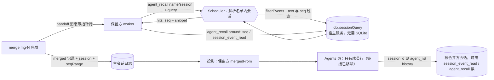

# 合并后的历史回取（merge recall）设计稿

> 状态：**已实现**（用户采纳了第 4 节全部推荐）。实测与上游问题草稿见第 7 节。
> 基线：`main` @ 9662d4a（含 #24 worker 合并、#26）。宿主：本机 DeepSeek Harness 0.2.2-rc.1（app.asar）；npm pinned 版本为 0.2.1-rc.5。
> 用户诉求：合并 worker 时保留被合并方的会话历史，以后能搜，「像把工具结果卸载出去、需要时再召回」。交接（handoff）就是卸载出去的摘要；召回（recall）是按需从归档会话里把原始细节取回来。
> 下文 `SQ/` 指 app.asar 里的 `dsh/node_modules/@deepseek-ai/`。

## 0. 结论先行

- **历史不会丢。** DSH 没有任何删除会话的代码路径。持久化层（`SQ/dsh-session-persistence-jsonl/lib/index.js`）里的 `rm` 只用来清理迁移和写入时的临时文件（:608、:2017、:2025、:3238-3256）；在所有 `dsh-*session*` / `*workspace*` 包里搜 `deleteSession` / `removeSession` / `purgeSession`，只命中搜索索引自己的派生表（`dsh-session-query-sqlite` 的 `_deleteSession`，删的是索引行，不是日志）。我们合并时用的「归档」是 `drainChildren`，只是把成员从内存里放掉，不碰日志。所以被合并 worker 的日志会一直留在 `~/.dsh/sessions/<ws>/<id>/`，除非用户手动删目录。
- **插件不能依赖全文搜索（`searchEvents`），也不需要。**
  - 宿主的 `ctx.sessionQuery`（就是我们已经在用的服务，契约 H13）是 `dsh-session-query-sqlite`，在 `dsh-base` 里配的是 `openAt: never`（`SQ/dsh-base/cordis.patch.yml:149-161`，注释原文：「search calls fail with SESSION_QUERY_SEARCH_DISABLED」）。插件调 `searchEvents` 一定报 `SEARCH_DISABLED`。
  - 「会话搜索」实验包（`dsh-experimental-session-search`）开的是**另一个**被 `isolate: { sessionQuery: true }` 隔离的 provider（`:memory:`，`openAt: first-search`），只供它自己的 `session_search` 工具使用，插件拿不到（`SQ/dsh-experimental-session-search/cordis.patch.yml`；README「The group owns an isolated `sessionQuery` provider … The host's metadata service keeps `openAt: never`」）。
  - 公开的 `ctx.sessionQuery.filterEvents(sessionId, filters)` 在宿主服务上可用，**不需要 SQLite**：它对**单个会话**的事件做大小写不敏感、空白宽松的字面扫描，支持 `seq`、`time`、`type`、`surface`、`text` 过滤，多个过滤条件之间是「与」（`SQ/dsh-session-query/README.md`「What you can do」「Filters」；`lib/index.js:1152-1160`）。pinned 0.2.1-rc.5 和 next 0.2.2-rc.1 都有（类型见 `dsh-session-query/lib/types/index.d.ts:118`、`types.d.ts:191-212`）。召回只需要在「一个已知会话里找」，这正是它的用途。
- **本机 `session_search` 总报「session history storage is unavailable」的原因。**
  - 这句文案对应 `SESSION_QUERY_PERSISTENCE_FAILED`（`SQ/dsh-tool-session-query/lib/index.js:355-357`）。不是 SQLite 装不上：SQLite 打不开会是另一种错误，`node:sqlite` 是在 `openSearchDatabase` 里加载的。
  - 它来自全文索引**首次建库时对整个语料的一次性观察**（`dsh-session-query-sqlite/lib/index.js:707-755`）：
    1. 列出所有持久化会话，逐个读入没加载过的冷会话；
    2. 再列一次，比较两次结果；
    3. 任何一个会话读失败、头信息不兼容，或者两次列举不一致（有会话在写）并且重试一次还不一致，**整个搜索就失败**。
  - 本机 `~/.dsh/sessions` 下有 281 个会话目录，其中有旧格式日志（`session.jsonl.zstd`），也有没有日志的空目录，而且 desktop 里 lead 和 worker 一直在写。所以全语料观察几乎稳定不下来，或者被某个坏会话拖垮。这是**宿主侧的问题，和插件无关**。`session_event_read` / `session_trace` 只读一个会话，所以能用。（本结论来自读源码和只读列目录，没有在 `~/.dsh` 上跑任何东西；实现阶段会在隔离的 `DSH_HOME` 里构造「写个不停的会话」和「一个坏会话」两种情况来复现，见第 6 节第 0 步。）
- **推荐：**
  1. 交接消息和 `agent_list` 带上会话指针；
  2. 新工具 `agent_recall`，只用 `filterEvents` 加 `readEvent`，经适配层调用；
  3. 范围限定在本主会话的名单之内；
  4. ~~Agents 页在保留方行上加「合并自 …」入口~~（用户看了截图后要求去掉，见第 7 节）。

## 1. 现状核实

| 问题 | 结论 | 出处 |
|---|---|---|
| 归档或合并后日志还在吗 | 在。插件归档用的是 `drainChildren`；DSH 没有删除会话的 API | 见第 0 节；`src/scheduler.ts` 的 `archive` / `finishMerge` |
| 保留方知道被合并方的会话 id 吗 | 不知道。交接消息里只有名字（`src/merge.ts` 的 `handoffMessage`） | #24 |
| `agent_list` 有会话 id 吗 | 没有（`src/tools.ts` 的 `agent_list`） | — |
| 合并后按旧名能找到谁 | `Ledger.find` 跟着 `mergedInto` 找到保留方，所以**按旧名拿不到被合并方本身**，召回需要单独的解析规则（2.2） | #24 |
| 压缩（compaction）后旧事件还能读吗 | 能。压缩只改「表面」：旧事件被标记为 `shadowed`，原始日志不删（`dsh-session-query/lib/index.js:645`）；`filterEvents` 不加 `surface` 过滤时会扫全部事件 | — |
| split 出来的 worker 的日志 | 开头是从源 worker 继承的种子（`inheritedEventCount`）。不排除的话，回取会把源 worker 的内容重复返回一遍 | `observeSession` 的 `inheritedEventCount`（契约 H13） |

## 2. 设计

### 2.1 保留指针

- **交接消息**（`handoffMessage`）多一行：
  ```
  [absorbed hub-image → session session-63a0…; its own events seq 412–1187, 9 rounds; recall with agent_recall({ name: "hub-image", query })]
  ```
  seq 范围从被合并方「自己的事件」开始（跳过继承的种子），到合并时日志的最后一条为止；轮数用 `completedRounds` 数出来。
- **merge 记录**：`merged` 动作多记 `session`（被合并方的 id）和 `seqRange: [from, to]`。投影里的成员加 `mergedFrom: [{ name, session, seqFrom, seqTo, at }]`，记在保留方身上，可以有多条，按合并顺序排列。
- **保留方的系统提示身份行**（`sectionFor`）：
  ```
  You absorbed: hub-image → session-63a0… (merged mg-1); use agent_recall to look up its history.
  ```
- **`agent_list`**：每个成员都带 `session`（会话 id）。新增 `history` 数组，列出已归档和已合并的成员：
  ```
  { name, session, state: "archived" | "merged", mergedInto?, formerNames? }
  ```
  这样旧名也能对应到会话。默认只显示最近 20 个，传 `history: true` 显示全部，避免工具结果过长。

### 2.2 `agent_recall` 工具

```
agent_recall({ name?, session?, query, limit? = 10, around? })
→ { session, name, ownedFrom, hits: [{ seq, type, turn?, time, snippet }], truncated, next? }
```

- **解析目标**（只在调用方自己的名单里找）：
  1. `session` 给了：必须是本主会话、或本主会话名单里任何成员（含已归档、已合并）的 id；
  2. `name` 给了：依次按「当前名字 → 某个成员的旧名 → 某条合并记录里被合并方的名字」查找，**不跟随 `mergedInto`**，因为召回要的就是被合并方本身；
  3. 一个名字对应多个会话（split 以后两个 worker 的旧名都是 `hub`）：按旧名查时返回候选列表，要求调用方改用 `session` 指定。
- **检索**：
  - `query` 按空白切成若干词，每个词一条 `{ kind: 'text' }` 过滤，再加 `{ kind: 'seq', from: inheritedEventCount }`，一起调 `filterEvents`。多个 `text` 条件之间是「与」，也就是「同一事件里包含所有词」。
  - 结果按 seq **倒序**取前 `limit` 条（最新的最有用），每条的 `snippet` 是第一个词附近 ±150 字。
  - 不做正则（见第 4 节第 3 点）。
- **细读**：返回结果提示用 `agent_recall({ session, around: seq })`。它调 `readEvent({ sessionId, seq, before: 3, after: 3 })`，返回那条事件的全文和前后的摘要。也可以直接用 DSH 原生的 `session_event_read`，它同样走 `sessionQuery`，读单个会话，不受全文索引故障影响。
- **谁能用**：lead、worker、分身都能用。分身本来就允许只读工具（`read`、`session_*`），`agent_recall` 加入 `FORK_TOOLS` 白名单。worker 只能查本主会话名单里的会话（含 lead 自己）。
- **不做的事**：
  - 不跨主会话、不跨工作区，所以不调用 `listSessions` / `searchSessions`；
  - 不写任何记录；
  - 结果不进 lead 收件箱。

### 2.3 适配层

`src/dsh/host/session-query.ts`（新）：

| 导出 | 用到的宿主能力 | 级别 |
|---|---|---|
| `filterSessionEvents(ctx, id, { terms, fromSeq, limit })` | `ctx.sessionQuery.filterEvents` | A（公开，有类型，有 README） |
| `readEventWindow(ctx, id, seq, n)` | `ctx.sessionQuery.readEvent` | A |
| `ownedFrom(ctx, id)` | `observeSession(...).inheritedEventCount`（已有，H13） | A |

宿主缺这些方法时，工具返回「此 DSH 不支持历史回取」，并 warn 一次（`features.record('sessionQuery.filterEvents', …)`）。`boundary.spec.ts` 规定业务代码只能经这一层访问 `sessionQuery`。

**契约测试**（`tests/contract/session-query.spec.ts`，pinned 和 next 都跑）：

1. `filterEvents` 的字面匹配大小写不敏感、多个 `text` 条件之间是「与」、支持 `seq` 范围；
2. **冷会话**（只在磁盘上，不在内存里）可读；
3. 压缩后被 shadow 的事件仍能匹配；
4. 宿主默认服务的 `searchEvents` 报 `SESSION_QUERY_SEARCH_DISABLED`。这条用来证明我们没有依赖它；哪天它放开了，测试会提醒重新评估。

### 2.4 Agents 页（可选，已按用户要求撤掉）

- ~~保留方行下的「↶ 合并自 …」链接~~：做成后用户觉得难看，已全部移除（行内标记、悬停样式、8 种语言的 `mergedFrom.*` 文案，以及只给它用的点击处理）。被合并方的会话仍可从 `agent_list` 的 `history` 里的 session id，或用 `agent_recall` 召回其历史。

### 2.5 代价与限制

| 项 | 处理 |
|---|---|
| 大日志 | `filterEvents` 会把整个会话读进内存再扫。冷会话靠宿主的 `preparedSessionCacheSize`（默认 5）缓存。我们再加三条保护：单次调用 10 秒超时（`AbortSignal.timeout`，超时报「历史太长，缩小词或用 seq 范围」）；`limit` 最大 50；`snippet` 截断。可选的 `fromSeq` / `toSeq` 参数用来缩小范围 |
| 压缩 | 原始日志保留，所以压缩前的细节仍能取回（契约测试第 3 条兜底） |
| 继承种子 | 默认从 `inheritedEventCount` 开始扫；`includeInherited: true` 才包含源 worker 的种子部分 |
| 隐私 | worker 能读同一主会话里其他成员的历史，包括用户直接在那个 worker 对话框里说的话。这一点需要用户定（第 4 节第 2 点） |
| 提示缓存 | 工具 schema 改一次（新增 1 个工具，`agent_list` 多一个字段），之后稳定；召回结果只追加在对话尾部 |
| 全文搜索 | 本稿不依赖。将来宿主把 `searchEvents` 开放给插件（不再隔离，或者 `openAt` 可用）时，适配层可以先试 `searchEvents`、失败再退回 `filterEvents`，工具接口不变 |

## 3. 数据流



## 4. 需要用户拍板的点

1. **范围**：只限本主会话的名单（推荐）；还是允许 lead 查同一工作区的其他会话（那就要用 `listSessions`，会碰到其他任务的内容）？
2. **隐私**：worker 能不能召回**其他成员**的历史，包括用户在那个成员对话框里直接说的话？
   - (a) 能（推荐，合并就是为了接手）；
   - (b) worker 只能召回自己合并进来的会话和 lead 的，其余只有 lead 能查。
3. **要不要正则**：推荐不要，用多个词「与」匹配已经够用；正则需要把整个会话的文档都拉出来自己扫，成本高。
4. **`agent_list` 默认显示多少历史成员**：推荐 20 个，传 `history: true` 显示全部。
5. ~~Agents 页的「合并自 …」入口~~：做过，用户要求去掉；现在没有任何界面入口。
6. **本机 `session_search` 的故障**：是否需要我在隔离环境复现后，向 DSH 提 issue（「首次建索引时，一个坏会话或一个一直在写的会话就让整个全文搜索失败」）？这不阻塞本功能。

## 5. 与已有能力

| 能力 | 影响 |
|---|---|
| #24 合并 | `merged` 记录多两个字段；旧记录没有这两个字段时，用 `absorbed` 的 id 补，seq 范围按「整个日志」处理 |
| split / `formerNames` / `splitHint` | 召回解析时**不**跟随 `mergedInto`；一个名字对应多个会话时要求改用 `session` 指定 |
| 派活锁、`rosterVersion` | 召回只读，不进锁，不改版本号 |
| 圆点、收件箱 | 不受影响 |
| #19 `isLive` | 召回不写主会话；主会话已释放时，名单从日志折叠出来照样能解析 |
| 重启恢复 | 无状态，不受影响 |
| i18n | 工具文案是英文（给模型看的）；Agents 页入口有 zh/en 和其他语种 |
| 适配层 | 新增 `dsh/host/session-query.ts`，加契约测试；不新增实验级依赖 |

## 6. 实现步骤

| 步 | 内容 | 测试 |
|---|---|---|
| 0 | 隔离 `DSH_HOME` 复现 `session_search` 故障（构造一个旧格式或损坏的会话，以及一个持续写入的会话），把结论补进本稿 | 截图或日志 |
| 1 | 适配层 `session-query.ts`；compat 能力探测；`boundary.spec` 规则 | `tests/contract/session-query.spec.ts`（pinned 和 next） |
| 2 | merge 记录加 `session` 和 `seqRange`，投影加 `mergedFrom`，交接消息加指针行，身份行 | `tests/merge.spec.ts` 补断言；旧记录兼容 |
| 3 | `agent_list` 带 `session` 和 `history` | `tests/user-workers.spec.ts` 或新增 |
| 4 | `agent_recall`（解析、多词与匹配、倒序取前若干条、片段、`around`、超时、范围检查），加入 `FORK_TOOLS` | 新 `tests/recall.spec.ts`：合并后按旧名召回被合并方、冷会话、压缩后、继承种子被排除、越界会话被拒、一名对多会话 |
| 5 | ~~Agents 页「↶ 合并自 …」；各语种文案~~（已移除） | 回归测试 `merged-from-gone.spec.ts`、`i18n.spec` |
| 6 | 隔离 GUI 实测：split → 合并 → 保留方用 `agent_recall` 取回被合并方的原话 → 重启后再取；截图；README；`docs/dsh-adapter.md` | — |

## 7. 实现与复现

- **复现 `session_search` 故障**：在隔离 `DSH_HOME=/tmp/recall-repro/home`（JSONL 持久化 + `dsh-session-query-sqlite`，`openAt: first-search`）里复现。脚本是 [session-search-repro.spec.ts.txt](repro/session-search-repro.spec.ts.txt)，输出是 [session-search-repro.log](repro/session-search-repro.log)。
  - **一个**回放校验失败的已存会话（例如 user 消息缺 `role`），就让所有搜索都失败：`SESSION_QUERY_PERSISTENCE_FAILED … stored session "old-1" failed validation`，每次搜索都复现，直到手动删掉那个目录。
  - 同一个库、同一个 context 下，`filterEvents` 读正常会话照常可用。
  - 一个持续写入的会话**没有**复现失败（重试一次后就稳定了）；目录里只有非日志文件时会被跳过。
  - 所以第 0 节的推测要修正：主因是「有一个坏会话」，不是「有会话在写」。英文 issue 草稿写在 [upstream-issue-session-search.md](upstream-issue-session-search.md)，**未提交**。
- **实现**：
  - `src/dsh/host/session-query.ts`（`historyPort`：`find` / `window` / `ownedFrom`）；
  - merge 记录加 `session`、`seqFrom`、`seqTo`、`rounds`，投影加 `mergedFrom`（状态版本 11）；
  - 交接消息加指针行（`historyLine`），保留方的系统提示加身份行；
  - `agent_list` 带 `session`、`mergedFrom`、`history`（默认 20 条）；
  - `agent_recall`，并加入分身白名单；
  - ~~Agents 页「↶ 合并自 …」~~（后按用户要求移除，见第 7 节）；
  - 8 种语言的文案。
- **测试**：
  - `tests/recall.spec.ts`；
  - 契约 `tests/contract/session-query.spec.ts`：R1–R3 是字面「与」匹配、seq 范围、冷会话；R4 是被 shadow 的事件仍能匹配；R5 是 `searchEvents` 仍报 `SEARCH_DISABLED`。这组用宿主真实的 `dsh-session-query-sqlite` 跑（开发依赖，随 `contract:next` 一起换成 next 版本）；
  - `boundary.spec` 新增一条规则：只有适配层读会话历史。

### GUI 实测（隔离 `DSH_HOME=/tmp/recall-gui/home`，mock 模型，调度关）

1. hub 拆成 hub-asr 和 hub-image。hub-image 的回报里提到「换成了 mozjpeg，质量 82」，交接只写了「换了编码器，细节见我的历史」。
2. 从 Agents 页把 hub-image 合并进 hub-asr，合并后改名 `hub`（[merged](img/merge-recall-2-merged.png)）。当时 hub 行下出现过「↶ 合并自 hub-image」，现已移除。
3. lead 让 hub 去查。hub 调 `agent_recall({ name: "hub-image", query: "mozjpeg 质量" })`，返回 `session-55dc…`、`ownedFrom: 30`，命中 seq 50，片段里有「质量 82」。hub 的答复就是这个数字。工具结果记录在 [recall-gui-tool-results.log](repro/recall-gui-tool-results.log)。
4. ~~点「↶ 合并自 hub-image」在右栏打开被合并方的会话~~：[link](img/merge-recall-5-merged-from-link.png) 记录了它当时的样子；该入口已随用户反馈移除。
5. 重启 DSH 后再问一次，`agent_recall` 照样从冷会话里取回「82」（[restart](img/merge-recall-6-restart.png)）。

### 后续：移除合并自链接（fix/drop-merged-from-link）

用户看了截图后认为「↶ 合并自 …」难看，要求去掉。改动：
- 行下方的链接、它的悬停/分隔样式、只给它用的点击处理，以及 8 种语言的 `mergedFrom.label` / `mergedFrom.title` 全部删除；
- 保留数据与召回：merge 记录仍存被合并方的 session id 和 seq 范围，`agent_list` 仍有 `session` / `mergedFrom` / `history`，`agent_recall` 仍能把旧名解析到被合并方的会话，保留方的系统提示仍有历史指针；
- 新增回归测试 `tests/merged-from-gone.spec.ts`：渲染 Agents 页，断言没有 `data-scheduler-merged-from` 元素、没有含 `merged` 的类名、没有「合并自 / merged from / ↶」文案（把链接加回去时该测试会失败）。
