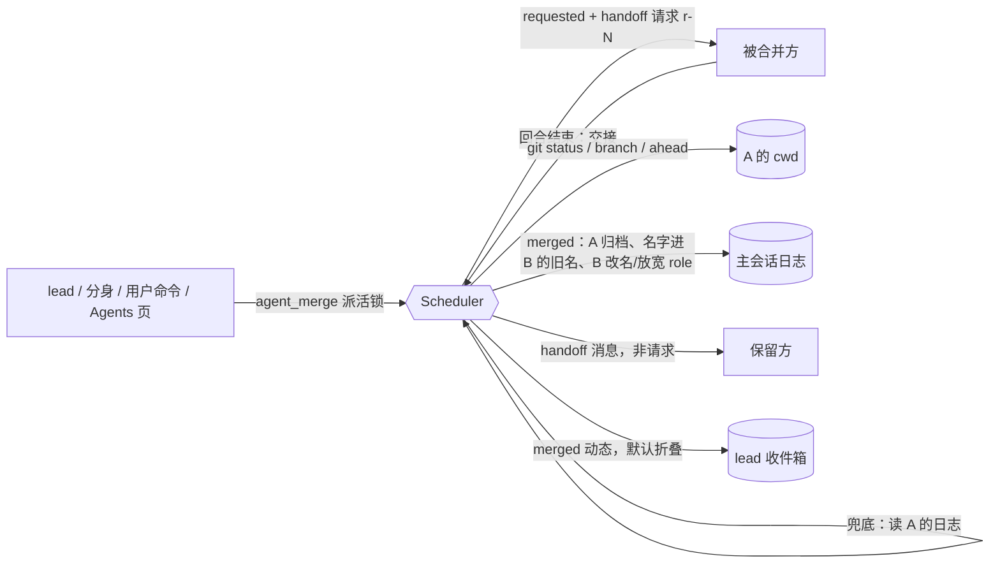

# worker 合并（merge）设计稿

> 状态：**已实现**（PR feat/worker-merge）。基线 `main` @ 806b386（含 #22 收件箱）。
> 需求：现存 worker，尤其是 `agent_split` 分出去的，要能合回一个。合并是 split 的反操作。

## 1. 规则

1. **交接由被合并方自己写。** 调度器给被合并方发一条特殊请求（handoff，也是一个 `r-N`），要求它按固定结构写交接：
   ```
   ## Done
   ## In progress
   ## Decisions
   ## Open questions
   ## Files changed
   ## Branch / PR
   ## Uncommitted changes
   ```
   交接用 `report` 或回合结尾的答复交回。被合并方已失败、已归档、从没启动过，或者它写交接的那一回合被切断时，改为**从它的日志生成交接**：取最近几个完成回合的结尾和它答过的请求。不用 DSH compaction，因此不新增宿主依赖。
2. **代码先收口。**
   - 被合并方正在跑，或还有未答请求：**拒绝**合并，提示先等它答完或先中断。
   - 交接请求要求它先提交（并推送），没提交的改动必须在 `## Uncommitted changes` 里写明，交给保留方接手。
   - 交接收回后，调度器在被合并方的 cwd 里跑 `git status --porcelain`、`git rev-parse --abbrev-ref HEAD`、`git rev-list --count @{u}..HEAD`：
     - 工作区有改动，而交接里这一节是空的或写着「none / 无」：合并**失败**，被合并方保持原样，lead 收到失败说明；
     - 其他情况：把这些检查到的事实（目录、分支、未提交文件、未推送的提交数）附在交接后面，一起交给保留方。
3. **名单上做 split 的反操作。**
   - 被合并方归档，记 `mergedInto` 指向保留方。它的名字和旧名进保留方的 `formerNames`，以后按这些旧名派活都落到保留方（`Ledger.find` 跟随 `mergedInto`）。
   - 保留方可以改名（`--name`）：新名字必须没人用过；或者是保留方自己用过的旧名；或者两方同属一个 area 时，用对方用过的名字（例如改回 split 前的 `hub`）。
   - role 默认放宽为「保留方的 role；也负责：被合并方的 role」，也可以用 `--role` 指定。
   - area 沿用保留方的；保留方没有 area 时用被合并方的。
4. **交接投给保留方**，作为一条非请求消息，抬头是 `[handoff mg-N from <absorbed>, merged into you; not a request]`。它不参与请求结算，handoff 请求也不给被合并方亮圆点。lead 收件箱只留一条默认折叠的 `merged` 动态。
5. **入口**
   - lead 工具 `agent_merge({ worker, with, into?, name?, role?, rosterVersion, for? })`：走派活锁，带 `rosterVersion`；调度开时 lead 必须传 `for`。分身也能用（路由类工具）；worker 不能用。
   - 用户命令 `/agents merge <absorbed> into <survivor> [--name <new>] [--role <text>]`。省略 `into` 时（`/agents merge a b`）由调度器挑保留方。
   - Agents 页 worker 行上的「合并到…」：选对方、选保留哪个、可选新名字。
   - **默认保留方**：手上有活（在跑或有未答请求）的一方；否则是 area 的原主（它的旧名里有 area 名，或旧名更多的一方）；再否则是先建的一方。

## 2. 状态机（插件记录 `plugin:dsh-agent-scheduler/merge`）

```
requested ──handoff 答复/日志兜底──▶ handoff ──git 检查──▶ settled ──归档+改名──▶ merged ──投递交接──▶ delivered
    │                                  │                                                │
    └────────────── 任一步不成立 ──────┴──────────────▶ failed（名单不变）               └ 投递失败：重启时重投
```

| 状态 | 记录内容 | 重启后怎么续 |
|---|---|---|
| `requested` | `mg-N`、absorbed、survivor、name?、role?、handoff 请求 `r-N`、by、for? | 请求仍开着：走原有的恢复（失败或续作）；请求失败（例如被重启切断）：转为**从日志生成交接**；请求已答：用答复继续 |
| `handoff` | 交接全文、来源（`worker` / `log`） | 重新跑 git 检查 |
| `settled` | git 事实 | 执行归档和改名 |
| `merged` | 最终名字、旧名、role、area；absorbed 被归档 | 交接还没投到保留方：重投（先在保留方日志里找 `handoff mg-N`，找到就不重投） |
| `delivered` | 保留方收到的消息 id | 结束 |
| `failed` | 原因 | 结束：名单不变，被合并方照常可用，lead 收到 `[merge mg-N … failed: …]` |

- 合并进行中（requested 到 merged 之间）：给被合并方派请求、改名或拆分任何一方、再把它们卷进别的合并，都**拒绝**，提示「正在合并」。合并要用的新名字也被预留。
- 被合并方在合并进行中被归档：交接请求随之失败，于是走日志兜底，合并照常完成。保留方在合并进行中被归档或失败：合并 `failed`。

## 3. 数据流



## 4. 与已有能力

| 能力 | 处理 |
|---|---|
| split 的 area / formerNames / splitHint | 合并把名字归给保留方；同 area 只剩一个 worker 时，splitHint 不再提示分裂 |
| #10 派活锁 | 发起合并和完成合并（归档、改名）都在锁内 |
| #9 圆点 | handoff 请求不给被合并方亮圆点；归档后它不留在 Worker 分组 |
| #22 收件箱 | 只进一条 `merged` 或失败动态；交接全文给保留方，不给 lead |
| #19 isLive | 所有写入都走 `record()`；异步步骤之后先查 `writable` |
| 重启恢复 | 见第 2 节；`recover` 结束后续推所有未完成的合并 |
| i18n | 命令回复、Agents 页文案都有中英文 |
| 适配层 | 不新增宿主依赖（git 与 `addWorktree` 同法，直接调 git 命令） |

## 5. 实测（隔离 `DSH_HOME=/tmp/merge-gui/home`，mock 模型，调度关）

| 步骤 | 截图 | 结果 |
|---|---|---|
| hub 拆成 hub-asr、hub-image（hub-image 在 worktree `feat/image`） | [1-split](img/worker-merge-1-split.png) | 同一个 area 下两个 worker |
| hub-image 行「合并到…」 | [3-form](img/worker-merge-3-form.png) | 默认保留 hub-asr（area 原主），新名字填 `hub` |
| 合并中 | [4-merging](img/worker-merge-4-merging.png) | 两行都标「合并中 mg-1」 |
| 合并完 | [5-merged](img/worker-merge-5-merged.png) | 剩 `hub`（role 已放宽），hub-image 已归档；lead 收到 `merged` 动态 |
| 保留方收到交接 | [6-handoff](img/worker-merge-6-handoff.png)、[6b-facts](img/worker-merge-6b-facts.png) | 非请求消息，带身份行、交接全文、git 事实（分支、未提交的 `src/`） |
| 重启 DSH 后按旧名 `hub-image` 派活 | [8-restart](img/worker-merge-8-restart.png) | 名单不变，请求落到 `hub`（`reply to r-5 from hub`） |
