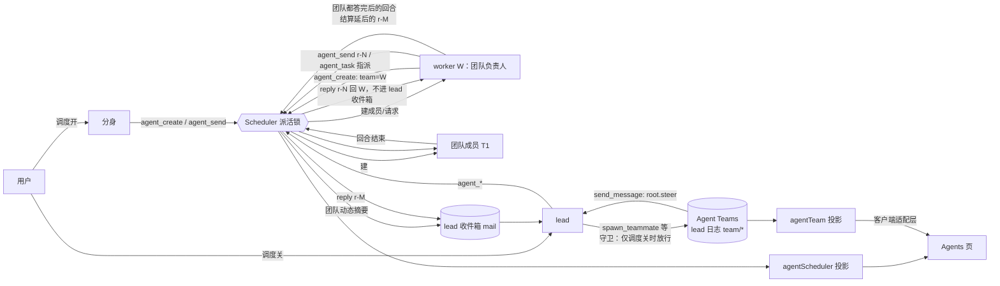

# 每个 worker 都是 teammate：Agent Teams 适配层与组队权限 设计稿

> 状态：**设计稿，待用户 CR**。本阶段不改 `src/`。
> 基线：`main` @ e149cba（v0.1.0-rc.3）。宿主：本机 DeepSeek Harness 0.2.2-rc.1（app.asar）。Agent Teams 各包同为 0.2.2-rc.1，npm 上 pinned 对应 0.2.1-rc.5、`next` 对应 0.2.2-rc.1。
> 用户原话：
> - 「每一个 worker 自己就是一个完整的 session，我希望每个 worker 都可以是一个 teammate」
> - 「为这个插件单独做一个 adaptor 适配层……关闭调度期间并且 agentteam 启用，主会话可以自己组建团队，开启的时候，主会话和 fork 的会话就不能自己组建团队了，但是 worker 随时都可以自己组建」

下文 `AT/` 指 app.asar 里的 `dsh/node_modules/@deepseek-ai/dsh-experimental-`，例如 `AT/agent-team/lib/index.js:1007`。文件用 `/tmp/dshasar/rd.mjs cat` 解出。

## 0. 结论先行

- **Agent Teams**：lead 下的一组具名、可续写的原生子会话（teammate），由 `ctx.subagents.startActivation` 创建。roster 和任务板写在 lead 日志里，成员之间可以直接发消息，共享一块带依赖、认领和 CAS 版本号的任务板。它是实验包：共享一个 cwd、名字不可改，只有 lead 能建人。
- **用户的规则在宿主现状下有一半能直接做，另一半不能：**
  - **调度关时 lead 组队：能直接用。** 主会话本来就是 Agent Teams 认的 Team Lead。
  - **调度开时禁止 lead 和分身组队：能做。** 我们已有的工具守卫（`ctx.tools.guard`）按角色和开关拒绝即可，不靠提示词。
  - **worker 随时组队：用原生 Agent Teams 做不到。** 有三道宿主硬限制（1.6 节）：
    1. Agent Teams 把带 subagent descriptor 的子会话（我们的 worker 就是）判为「非成员」，worker 当不了 Team Lead，Team 工具也不会装给它；
    2. DSH 默认 `subagent.maxDepth = 1`，worker 自己再建子会话（深度 2）会被拒；
    3. teammate 的 parent 只能是 Team root。
- **推荐**：
  - 新增 Agent Teams 适配层 `src/dsh/host/agent-team.ts` 和客户端对应的一层，只有这一层碰实验包；探测不到或形状不对就整体 no-op，warn 一次。
  - **lead 组队用原生 Agent Teams**，开关由我们的守卫控制。
  - **worker 组队由我们的调度层实现**，语义对齐 Agent Teams。teammate 仍是主会话的直接子会话（不受深度限制），但在账本里属于这个 worker 的团队：worker 是团队负责人，团队成员的答复和消息回到 worker，不进 lead 收件箱。worker 再按我们原来的请求结算答复 lead。
  - 这样做不要求宿主改动；等 Agent Teams 将来支持「子会话当 Team Lead」，适配层再切到原生实现。

## 1. Agent Teams 是什么（带出处）

### 1.1 teammate

| 问题 | 结论 | 出处 |
|---|---|---|
| 是否原生子会话 | 是。`spawnAdmitted` 调 `ctx.subagents.startActivation({ delivery: 'parent', childId, provider, label, request: { prompt, parent: root } })`，建出的是 lead 的直接、可续写子会话 | `AT/agent-team/lib/index.js:1007-1077`（:1043-1052） |
| 怎么建 | 只有 lead 能建：`spawnTeammate(caller, { name, description, prompt, context: fresh/fork, provider })`。fresh 用 `spawn` provider，fork 用 `fork` provider（从 lead 已完成的轮次 fork） | `AT/agent-team/lib/index.js:1007-1010`；`AT/agent-team/README.zh.md:60-64`；`AT/tool-agent-team/README.zh.md:44-55` |
| 能否指定 cwd | **不能**。请求里没有 cwd，成员共享 lead 的工作目录；README 写明「不支持独立工作目录」 | `AT/agent-team/lib/index.js:1018-1025, 1043-1052`；`AT/agent-team/README.zh.md:32, 203` |
| 名字 | 第一条 provisioning 记录占住名字，永不复用；roster「扁平且不可变」：不能改名、不能删除、不能嵌套 | `AT/agent-team/README.zh.md:60, 126, 205` |
| 持久化 | 先在 lead 日志追加并 flush 一条 `team/member`（`version: 2, teamId, member: { id, name, description, provider, context, phase }`），phase 依次为 `provisioning` → `active` / `failed`。重启时对照子会话的 descriptor 对账 | `AT/agent-team/lib/index.js:1027-1041, 1115-1150`；`AT/agent-team/README.zh.md:126, 144` |
| 成员身份怎么判定 | `tryMembership(agent)`：agent 的父会话是 root，且 root 日志的 Team 状态里有这个 id、phase 为 active 或 provisioning，才算 teammate。其余带 subagent descriptor 的子会话一律**不是成员**（因此我们现在的 worker 不是成员） | `AT/agent-team/lib/index.js:873-910` |
| 上限 | `maxMembers` 默认 16，组合包配 8，失败的也计数 | `AT/agent-team/README.zh.md:51`；`AT/agent-team-profile/cordis.patch.yml` |

### 1.2 roster、消息、任务板的数据模型和 API

服务是 `ctx.agentTeams`（`TeamService`，`super(ctx, "agentTeams")`，`AT/agent-team/lib/index.js:1454-1455`）。它的公开方法（`:1488-1580`）每个都要求传入调用方的确切 live `Agent` 作为权限凭据：

| 能力 | 服务方法 | 数据与语义 | 出处 |
|---|---|---|---|
| roster | `listMembers(agent)` | lead 一行，加每个 teammate 的 `{ id, name, role, status: running/inactive/provisioning/failed, description, provider, context, model, diagnostics }` | `:912-940, 1496` |
| 建人 | `spawnTeammate(lead, req)` | 见 1.1 | `:1505` |
| 消息 | `sendMessage(caller, { target, content, signal })` | 任何成员都能发给任何其他成员或 lead，不能发给自己。内容前面加一行 `Team message from <name>:`，source 为 `agent-message` relay。发给 lead 用 `root.steer()`；发给 teammate 用 `steerHostSubagentPrompt`，它来自 **`@deepseek-ai/dsh-subagent/internal`**（内部导出），会冷恢复不活动的成员。不留发送意图，不重试，不去重 | `:1514-1525, 1585-1612`；`:4`（import）；`AT/agent-team/README.zh.md:66-70, 130-132` |
| lead 怎么收 | 直接 steer 进 lead 的下一步，不经过任何队列 | `:1600-1606` |
| 任务板 | `createTask`、`getTask`、`listTasks`、`updateTask` | 任务是完整版本化快照：`{ id: task-N, revision, subject, description, status: pending/in_progress/completed/deleted, blockedBy[], writeScopes[], ownerId? }`。依赖全部完成后才能认领。每次更新都要带 `expectedRevision`（CAS），过期就报 `TEAM_TASK_STALE_REVISION`。认领、释放、完成由 owner 或 lead 操作，lead 还能指派。`writeScopes` 只作提示 | `:1210-1250, 1275-1300`；`AT/agent-team/README.zh.md:72-78, 136` |
| 等待 | `waitForChange(caller, timeoutMs)` | 等下一次 roster、任务、消息或成员状态变化，10 秒到 1 小时 | `:1563`；README `:80-82, 140` |
| 中断 | `interrupt(lead, name)` | 只有 lead 能中断；不清 inbox，不释放任务 | `:1573`；README `:84` |
| 浏览器视图 | `agentTeam` 会话投影 | 每次变化都把整个 roster 和任务板推给所有已连接的浏览器 | README `:172-176, 201`；`AT/agent-team/lib/types/projection.js:127-146` |

### 1.3 工具和 UI

- **工具**（`AT/tool-agent-team`）：一共 9 个——`spawn_teammate`、`send_message`、`list_agents`、`wait_agent`、`interrupt_agent`、`team_task_create`、`team_task_list`、`team_task_get`、`team_task_update`。它们**只注册在 Team 成员自己的 `ctx` 上**，lead 和每个 teammate 都拿到同一套 schema，外加一段 `team:policy` 系统提示和 runtime context 里的身份说明。其中 4 个名字和旧的全局 subagent 控制工具重名，所以组合包把 `tool-subagent-control`、`tool-subagent`、`tool-subagent-fork` 禁掉了。出处：`AT/tool-agent-team/README.zh.md:12, 59-66, 86, 92-94, 117-127`；`AT/agent-team-profile/cordis.patch.yml`。
- **UI**（`AT/client-ui-agent-team`）：挂在会话头部插槽 `conversation.session.header.actions` 上，是一个悬停或点击打开的浮层。里面是成员列表加**只读**任务板（不能在 UI 上改任务），点成员会打开它的会话。出处：`AT/client-ui-agent-team/lib/client.js:665-666`；`AT/client-ui-agent-team/README.zh.md:27-37, 43-49`。

### 1.4 哪些是公开 API，哪些只有工具能用

- `ctx.agentTeams` 的方法都是服务上的公开方法。但整个包标着「实验原型，无稳定性承诺」（README `:202`），而且包名本身就带 `experimental`。
- **没有「把已有子会话登记为成员」的 API**。成员只能经 `spawnTeammate` 产生；roster 状态从 lead 日志里的 `team/member` 折叠出来，写入走的是私有的 journal 事务（`:143-170`）。
- 给 teammate 发消息依赖 `@deepseek-ai/dsh-subagent/internal`，这是宿主的内部路径。

### 1.5 和 `ctx.subagents`、和我们插件的关系

- Agent Teams 建立在 `ctx.subagents` 上（它用 `startActivation`、descriptor 和内部的 host steer）。我们的插件也直接用 `ctx.subagents` 服务，**不依赖**组合包禁掉的那三个工具行，也没有同名工具（我们的工具都叫 `agent_*`）。所以两者同开时**不会互相把对方弄坏**。
- 但同开时会有：
  - lead 同时拿到 `spawn_teammate` 和 `agent_create` 两套派人机制，工具多出 9 个，外加一段 Team 策略文本；
  - 两套成员列表：Agents 页和头部的 Team 浮层；
  - 我们的 worker 不在 Team roster 里，看不到 Team 工具，Team 成员也看不到我们的 worker。

### 1.6 worker 当 Team Lead 的三道硬限制

| # | 限制 | 出处 |
|---|---|---|
| L1 | `tryMembership(agent)`：agent 有父会话、父会话的 Team 状态里没有它，**且它有 subagent descriptor** → 返回 `undefined`（非成员）。只有不带 descriptor 的会话才会被判为 `lead`。我们的 worker 是带 descriptor 的可续写子会话，所以既不是 teammate，也不是 Team Lead | `AT/agent-team/lib/index.js:873-910`（:893 `if (this.subagentDescriptor(agent)) return void 0`）、`:1186-1188` |
| L2 | Team 工具只装给成员：`maybeInstall` 跳过 `tryMembership === undefined` 的 agent，所以 worker 拿不到 `spawn_teammate` 这 9 个工具 | `AT/tool-agent-team/lib/index.js:538-545` |
| L3 | `@deepseek-ai/dsh-subagent` 的 `maxDepth` 默认是 1，`dsh-base` 的 `subagent` 行没有覆盖它。worker 深度为 1，它再建的子会话深度为 2，会被拒（`subagent depth 2 exceeds maxDepth 1`） | `dsh/node_modules/@deepseek-ai/dsh-subagent/lib/index.js:2993`、`:262-266`；`dsh-base/cordis.patch.yml:363-364` |

要绕过 L1 / L2，只能伪造 Team 记录或改宿主。要绕过 L3，需要改用户 profile 里的 subagent 配置，而这个配置对所有会话生效。这些都不应由插件去做，所以 worker 的团队由我们自己实现（第 3 节）。

## 2. 我们已有的能力（方案要和这些共存）

| 能力 | 现状 |
|---|---|
| worker 是完整会话 | lead 的原生可续写子会话，有自己的 cwd 或 worktree（一个目录只给一个 worker），用户可以直接对话 |
| 先粗后细 | 一个仓库或模块一个 worker，撞车了才用 `agent_split` 拆：老 worker 改名、收窄 role，新 worker 从它的对话 fork（我们自己的 `fork-from` provider） |
| 派活 | 请求 `r-N` 经 `agent_send` / `agent_create` 发出，结算看 worker 的回合认领了哪条消息。**所有答复都回 lead**（一条管道） |
| 派活锁 | `rosterVersion` 乐观校验，同一主会话的派活串行执行 |
| worker 互派 | worker 能 `agent_list`、`agent_send`，但这条请求的答复也回 lead，不回发问的 worker |
| 圆点、收件箱 | 待看的成员亮圆点（seen 记录）；lead 忙时答复先进收件箱（PR #22） |
| 适配层、契约、i18n、重启恢复 | 宿主依赖集中在 `src/dsh/`，有 pinned 和 next 两套契约测试；中英文词典；`recover` 处理被重启切断的工作 |

## 3. 推荐方案：Agent Teams 适配层 + 按角色和开关的组队权限

原来的方案 A（把 worker 登记成 Team 成员）、B（以 Team 为 worker 底座）、C（插件内补齐）收敛为一个方案：**lead 用原生 Agent Teams（经适配层，开关由守卫控制），worker 用调度层实现的团队（语义对齐 Agent Teams）**。

- 方案 A 要伪造 `team/member` 记录，还是绕不过 L1、L3，放弃。
- 方案 B 丢掉 worktree、`agent_split`、改名，放弃。
- 方案 C 的内容并入本方案，作为 worker 团队的实现。

### 3.1 Agent Teams 适配层

| 文件 | 职责 |
|---|---|
| `src/dsh/host/agent-team.ts`（新） | 唯一碰 `ctx.agentTeams` 和 Team 工具名的地方。<br>`teamsOf(ctx)`：探测服务，返回一个窄化的 `TeamPort { enabled, isMember(agent), listMembers(lead), TOOL: {...} }`；缺失或形状不对时返回 `{ enabled: false }`，warn 一次。<br>`TEAM_TOOLS`：9 个工具名，分为「建成员类」（`spawn_teammate`）、「管成员类」（`interrupt_agent`）、「协作类」（`send_message`、`list_agents`、`wait_agent`、`team_task_*`） |
| `src/dsh/client/agent-team.ts`（新） | 客户端读 `agentTeam` 会话投影，只读成员和任务两个字段，拿不到就返回 undefined；提供「打开 Team 浮层」的入口（如果宿主没给 API，就只做跳转到成员会话） |
| `src/dsh/compat.ts` | 新增可选能力 `agentTeams`（缺了不影响调度） |
| `tests/contract/agent-team.spec.ts`（新） | pinned（0.2.1-rc.5）和 next（0.2.2-rc.1）都跑：<br>① 服务方法存在；<br>② 9 个工具名仍存在（扫已安装包源码，和 H10b 同法）；<br>③ L1 仍成立：带 descriptor 的子会话不是成员。成立就继续走自建的 worker 团队；不成立说明宿主放开了，测试提醒切到原生实现；<br>④ `agentTeam` 投影的字段形状 |

业务代码（`scheduler.ts`、`fork-guard.ts`、`tools.ts`、客户端）只通过这个 `TeamPort` 使用 Agent Teams，`boundary.spec.ts` 加一条规则：`src/dsh/*/agent-team.ts` 以外不得出现 `agentTeams` 或 `experimental`。

### 3.2 权限矩阵（由工具守卫强制）

守卫和现在的分身守卫是同一个 `ctx.tools.guard`，在所有 pre-execute 之后、工具体执行之前跑，`run_code` 里的嵌套调用也会经过它（契约 H10）。被拒的工具调用返回固定文案，例如：「调度开着：组队交给 worker。用 agent_create / agent_split 派 worker。」

**原生 Agent Teams 工具**（只装在 Team 成员身上，实际只有 lead 和 lead 的原生 teammate 会有）：

| 角色 \ 条件 | `spawn_teammate` | `interrupt_agent` | `send_message` `list_agents` `wait_agent` `team_task_*` |
|---|---|---|---|
| lead，调度**关**，组合包开 | ✅ | ✅ | ✅ |
| lead，调度**开** | ❌「组队交给 worker」 | ✅（只能管已有 teammate，见 5.2） | ✅（同左） |
| 分身（任何时候） | ❌ 本来就没装（不是成员），守卫再兜一层 | ❌ | ❌ |
| worker | 没装（L2） | 没装 | 没装 |
| lead 的原生 teammate | ❌（Agent Teams 本身限定只有 lead 能建） | ❌ | ✅ |

**我们的工具**（`agent_*`），新增两项：`agent_message`（直接消息，不是请求）和 `agent_task`（团队任务板，一个工具用 `action` 区分，减少工具数）：

| 角色 | `agent_create` / `agent_split` | `agent_send` | `agent_message` | `agent_task` | `agent_list` |
|---|---|---|---|---|---|
| lead，调度开 | ✅（派 worker） | ✅ | ✅ | 只读（看各团队） | ✅ |
| lead，调度关 | ✅ | ✅ | ✅ | 只读 | ✅ |
| 分身 | ✅（只能建一个，规则照旧） | ✅ | ✅ | ❌ | ✅ |
| **worker** | ✅ **建出的是自己团队的成员**（团队负责人 = 自己） | ✅ | ✅ | ✅（自己团队的任务板，可以建、指派、认领） | ✅（自己的团队排在最前） |
| worker 的团队成员 | ❌（团队扁平，和 Agent Teams 一致；见 5.4） | ✅（只能发给本团队成员和负责人） | ✅（同左） | ✅（认领、完成自己的任务） | ✅（只看本团队） |

「建成员类」只拦创建：调度开时，lead 已有的原生团队仍然可以收尾（发消息、改任务、中断），不会被冻住。

### 3.3 worker 的团队怎么实现

- **成员仍是主会话的直接子会话**，和所有 worker 一样，不受 `maxDepth` 限制，也继续享有 worktree（`agent_create` 的 cwd、repo、branch）、改名、拆分、模型选择、圆点、重启恢复。账本里成员记录多一个字段 `team: <负责人 worker 的 Session id>`（`agent` 记录的 `created` 动作上加 `team`）。
- **答复回负责人**：团队成员答复负责人的请求时，答复以 `[reply to r-N from <成员>]` 投回负责人 worker（`port.send`，主会话代发）。**不进 lead 收件箱**；lead 收件箱只收到一条摘要「hub 的团队：hub-a 答复了 r-7」（种类为「团队动态」，默认折叠，见 5.3）。
- **负责人自己的请求延后结算**：lead 给负责人 W 的请求 r-M，只要 W 还有发给自己团队、尚未答复的请求，W 回合结束时 r-M 就**不结算**。等团队答复都回来、W 在新的回合里收尾后，才用那个回合的结尾答复 r-M。账本记录 `deferred`，重启后依旧成立。这样 lead 收到的是负责人汇总后的结论，不是半成品。
- **直接消息** `agent_message(to, text)`：不开请求、不结算；对方收到 `[message from <name>, not a request]`；发给 lead 的进收件箱。
- **任务板** `agent_task`：插件记录 `plugin:dsh-agent-scheduler/task`，每个团队一块。数据模型对齐 Agent Teams（`task-N`、`revision`、`subject`、`description`、`status`、`blockedBy`、`owner`、`writeScopes`），使用 CAS 版本号，依赖成环时拒绝。负责人指派任务 = 给成员发一条带 `task-N` 的请求，请求结算时任务自动标为 completed。
- **提示**：worker 的系统提示段加一句「你可以组建自己的团队：agent_create 建成员（先粗后细），agent_send 派活，agent_task 管任务板；团队的答复回到你，你汇总后结束回合，答复会交给 lead」。团队成员的段落说明它的负责人是谁。

### 3.4 组合包禁用 subagent 工具的影响

| 被禁的行 | 对我们 | 对 worker 组队 |
|---|---|---|
| `tool-subagent`（`subagent`）、`tool-subagent-fork`（`subagent_fork`）、`tool-subagent-control`（`send_message` 等旧控件） | 无影响：我们直接用 `ctx.subagents` 服务，不依赖这些工具。提示里本来就写着「不要用 send_message 或 subagent 工具」 | 无影响：worker 组队走我们的 `agent_*` |

需要改的地方：

- **lead 的提示文案**：调度关且组合包开时，`send_message`、`list_agents` 指的是 Agent Teams 的工具，lead 可以用来和自己的 teammate 交流。`LEAD_OFF_NOTICE` 里「Do not use send_message」改为按适配层探测结果生成：「send_message / list_agents 是你自己 Team 的工具；worker 用 agent_*」。
- **分身守卫白名单**（`fork-guard.ts` 的 `FORK_TOOLS`）：不用加任何 Team 工具名。分身不是 Team 成员，本来就没装 Team 工具；守卫默认拒绝白名单外的一切，等于再兜一层。白名单只新增我们自己的 `agent_message`。
- **能否共存**：能。两套派人机制分属不同角色：调度关时 lead 可以同时用 `spawn_teammate` 和 `agent_create`（见 5.1），调度开时只有 `agent_*`。
- **工具数和缓存**：组合包开时，lead 多 9 个 Team 工具 schema 和一段 `team:policy`；这由宿主决定，插件拿不掉。调度开时这些 schema 仍在 lead 的前缀里，只是被守卫拒绝，前缀稳定，不影响缓存。我们新增 2 个工具（`agent_message`、`agent_task`），改动一次前缀。

### 3.5 UI

```
Agents                                      ✓ ＋ ⇥
6 个 · 2 在跑
[Worker 默认模型 ▾]
┌ ✉ 待 lead 处理 1 ……（收件箱）                    ┐
└──────────────────────────────────────────────────┘
lead 的团队（Agent Teams）· 调度开时不能新建  [在 Team 面板打开]
  ● reviewer   teammate · 空闲                     ›
Worker
▾ ● hub        团队负责人 · 2 成员 · 任务 3/5    在跑 ›
    ├ ● hub-asr     task-2 · 在跑                    ›
    ├ ○ hub-image   task-4 · 空闲                    ›
    └ ☑ 任务板 ▸  task-1 ✓ task-2 ● task-3 ◌ task-4 ○ task-5 ○
  ● docs                                         空闲 ›
```

- worker 行可以展开：下面缩进显示它的团队成员（点成员打开其会话，圆点规则照旧），以及该团队的任务板（可展开；也可以在 UI 上新建、指派，走 `/agents task …` 命令）。
- 「lead 的团队」分区只在组合包开着且 lead 有 teammate 时出现，数据来自适配层读取的 `agentTeam` 投影。行内点击直接打开该成员会话；「在 Team 面板打开」跳到 Agent Teams 自带的头部浮层。
- worker 的团队**不出现在 Team 浮层**（L1：它不是 Agent Teams 的团队），只在 Agents 页显示。
- 新文案全部进 zh / en 词典。

### 3.6 数据流



### 3.7 和已有能力的关系

| 能力 | 影响 |
|---|---|
| 请求和结算 | 新增「负责人请求延后结算」（3.3）；其余不变。团队内的请求同样是 `r-N` |
| 派活锁和 `rosterVersion` | 团队成员的创建和请求都走同一把锁；`rosterVersion` 计入 `team` 字段。原生 Agent Teams 的操作不经过我们的锁（不是我们的成员） |
| 圆点 | 团队成员是我们的成员，规则照旧；原生 teammate 不亮我们的圆点（用户定是否纳入，见 5.1） |
| 收件箱 | 团队内的答复不进收件箱，只有一条摘要。注意：原生 Team 的 `send_message` 发给 lead 时直接 `root.steer`，**绕过我们的收件箱**（`AT/agent-team/lib/index.js:1600-1606`）；只在调度关时发生，lead 本来就在和用户直接对话，可以接受 |
| 重启恢复 | 团队成员的请求、延后结算、任务板都在插件记录里，`recover` 照常处理；原生团队由 Agent Teams 自己恢复 |
| i18n | 新分区、权限拒绝文案、`/agents task` 回复都有中英文 |
| #19 `isLive` | 所有新写入都走 `record()` / `writable()`；适配层只读，不写主会话 |
| 适配层与契约 | 新增可选依赖 `agentTeams`（实验级），pinned 和 next 都跑契约；缺失时整体降级，调度不受影响 |

## 4. 实现分几步

| 步 | 内容 | 主要文件 | 测试 |
|---|---|---|---|
| 1 | Agent Teams 适配层（host 和 client）、compat 能力、boundary 规则 | `src/dsh/host/agent-team.ts`、`src/dsh/client/agent-team.ts`、`compat.ts` | `tests/contract/agent-team.spec.ts`（pinned 和 next）；缺失或形状不对时降级的测试 |
| 2 | 组队守卫：按角色和开关拒绝 `spawn_teammate`；`LEAD_OFF_NOTICE` 按探测结果生成 | `fork-guard.ts`（改为通用守卫）、`scheduler.ts`、`rule-plugin.ts` | 用真实的 Agent Teams 组合（测试里挂实验包）跑 3.2 的每一格 |
| 3 | worker 团队：`team` 字段、`agent_create` 由 worker 发起时自动入队、`agent_list` 按团队排列、答复回负责人、团队动态摘要 | `records.ts`、`projection.ts`、`scheduler.ts`、`tools.ts` | `tests/worker-team.spec.ts` |
| 4 | 负责人请求延后结算（含重启） | `scheduler.ts`、`rounds.ts`、`recovery.ts` | 延后结算、重启后仍延后、团队成员失败时负责人照样收尾 |
| 5 | `agent_message`、`agent_task`（CAS、依赖、指派即请求、结算时自动完成）、`/agents task` | `scheduler.ts`、`tools.ts`、`rule-plugin.ts` | `tests/task-board.spec.ts` |
| 6 | Agents 页：worker 行展开团队和任务板、「lead 的团队」分区、中英文 | `client/team.tsx`（新）、`client/index.tsx`、`i18n/*` | 渲染测试、`i18n.spec` |
| 7 | 隔离 GUI 实测（显式 `DSH_HOME=/tmp/…/home`，开组合包）、README、`docs/dsh-adapter.md` | — | 截图 |

## 5. 需要用户拍板的点

1. **调度关时 lead 用 `spawn_teammate` 建的原生 teammate 算不算我们的 worker？**
   - (a) 不算，只在「lead 的团队」分区显示（推荐：它们没有 worktree、不能改名拆分，硬并进来会破坏 worker 的语义）；
   - (b) 算，进 Worker 列表，亮圆点。
   另外，调度关时 lead 同时有 `spawn_teammate` 和 `agent_create`：两者都放行（推荐），还是只留其一？
2. **调度从关切到开时，lead 已有的原生团队怎么办？**
   - (a) 保留，只禁止新建；已有 teammate 可以继续发消息、改任务、被中断（推荐）；
   - (b) 切换时把它们的当前回合全部中断；
   - (c) 切换时问用户。
3. **团队内的答复要不要在 lead 收件箱留摘要？** 推荐留一条默认折叠的「团队动态」；或者完全不留，只在 Agents 页的团队里看。
4. **团队能否嵌套？** 团队成员能不能再组自己的团队。推荐**不能**（扁平，和 Agent Teams 一致）；如果放开，同样只是账本上的嵌套，不受深度限制。
5. **负责人请求延后结算**：推荐「等团队请求都答完」。另一种是负责人回合一结束就答复 lead，团队结果另走「团队动态」。前者 lead 收到的是完整结论，后者更快但会收到半成品。
6. **worker 团队的人数上限**：沿用全局并发容量（`maxActiveSubagents`），还是每个团队单独设上限（例如 6）？
7. **长期方向**：要不要给 DSH 提需求，让 Agent Teams 允许「子会话当 Team Lead」并放开深度（L1、L3）？放开后适配层可以把 worker 团队切到原生实现，届时 worker 的团队也能进 Team 浮层。
